# 📦 Supply Chain Analytics Using Python
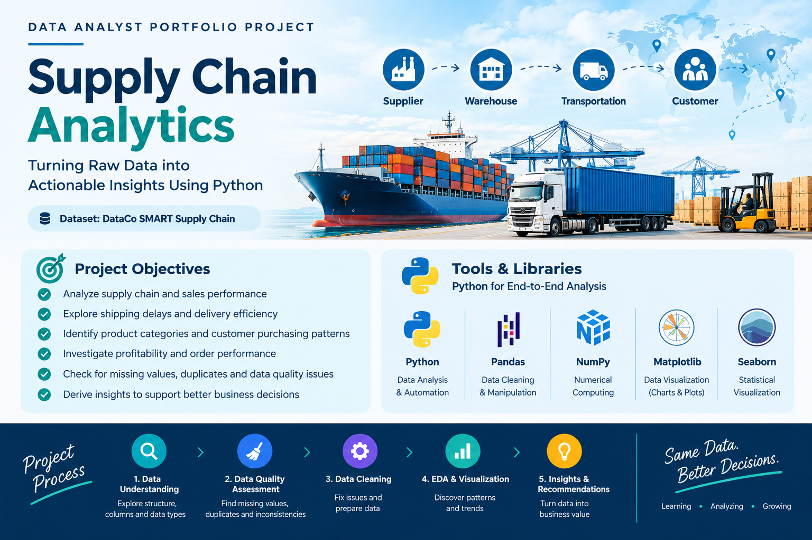
### Inventory, Logistics Performance, and Demand Analysis


**Project Type:** Data Analytics Portfolio Project
**Domain:** Supply Chain & Logistics Analytics
**Programming Language:** Python
**Dataset:** DataCo SMART Supply Chain
**Project Date:** October 2026

---


## 📌 1. Project Overview

Supply chain management plays an important role in ensuring that products move efficiently from manufacturers and warehouses to customers. Effective supply chain operations require proper demand planning, inventory management, order fulfillment, logistics coordination, and financial performance monitoring.

This project, **Supply Chain Analytics Using Python**, focuses on analyzing the DataCo SMART Supply Chain dataset to identify operational inefficiencies, understand customer demand, evaluate product movement, investigate delivery performance, and assess order-level profitability.

The project uses Python-based data analytics techniques to transform raw transactional data into meaningful business insights.

The analysis covers four major areas:

- **Inventory Management:** Understanding product movement and identifying fast-, medium-, and slow-moving products using historical demand.
- **Demand Analysis:** Examining product demand, sales patterns, customer segments, geographical demand, and order trends.
- **Logistics Optimization:** Investigating delivery delays, shipping performance, delivery risk, and order fulfillment efficiency.
- **Profitability Analysis:** Evaluating profit distribution, loss-making transactions, discount impact, and profitability across different business segments.

The ultimate goal is to identify the factors affecting supply chain efficiency and profitability and provide data-driven recommendations for improving business operations.

---

## 🎯 2. Business Problem

The primary business problem is poor supply chain and delivery performance, which is causing substantial profit leakage despite strong sales and customer demand. The company has strong market demand but suffers from severe order fulfilment and logistics inefficiencies, leading to excessive delivery delays, financial losses, and a high number of loss-making transactions.

The problem shows up in the data in three ways:

| Symptom | Evidence from the notebook |
|---|---|
| Strong demand and sales | $35.2M total sales, 367,591 units, 20,261 customers, average order value $560 |
| Excessive delivery delays | 54.69% of orders arrive later than scheduled (34,400 of 62,897 orders) |
| Financial leakage | $3.7M of loss on loss-making lines, against $7.5M of positive profit, leaving a net profit of $3.8M |
| High number of loss-making transactions | 32,295 of 172,765 order lines (18.69%) have negative profit |
---

## 🎯 3.Objective

To identify the key factors contributing to supply chain inefficiencies, delivery delays, and profit losses by analysing sales, demand, inventory, order fulfilment, and logistics performance.

### Supporting objectives

1. Clean, preprocess and transform the dataset for accurate analysis.
2. Establish overall performance through business KPIs.
3. Analyse demand across products, categories, segments and regions.
4. Classify products as fast-, medium- or slow-moving from historical quantities.
5. Evaluate sales and profitability, including the role of discounts and prices.
6. Compare scheduled and actual shipping durations.
7. Examine delivery delays by shipping mode and region.
8. Turn the patterns into data-driven recommendations.

---

## 📂 4. Dataset Information

| Item | Detail |
|---|---|
| Name | DataCo SMART Supply Chain for Big Data Analysis |
| Source | Mendeley Data |
| Link | https://data.mendeley.com/datasets/8gx2fvg2k6/5 |
| Raw size | 180,519 rows and 53 columns |
| Cleaned size | 172,765 rows and 43 columns |
| Period | Orders from 1 January 2015 to 31 January 2018 |
| Unit of observation | One order line (`Order Item Id`); one order (`Order Id`) can have several lines |
| Coverage | 62,897 orders, 20,261 customers, 118 products, 50 categories, 11 departments, 5 markets, 23 regions, 164 countries |

| Category | Important Columns |
|---|---|
| Order Information | Order Id, Order Date, Order Status |
| Customer Information | Customer Id, Customer Segment, Customer City, Customer Country |
| Product Information | Product Id, Product Name, Category Name |
| Demand Information | Order Item Quantity |
| Sales Information | Sales, Order Item Total |
| Profitability | Order Profit Per Order |
| Discount | Order Item Discount, Order Item Discount Rate |
| Shipping | Shipping Mode, Scheduled Shipping days |
| Delivery | Actual Shipping Days, Delivery Status, Late Delivery Risk |
| Geographical Information | Market, Order Region, Order Country |

The dataset contains historical transactional information that allows the analysis of customer demand, product movement, delivery operations, and financial performance.

---

## 🛠️ 5. Technologies and Tools Used


| Technology | Purpose in this project |
|---|---|
| Python | Overall analytical workflow |
| NumPy | Conditional logic (`np.select`, `np.where`) and numerical operations |
| Pandas | Cleaning, type conversion, feature creation, grouping and aggregation |
| Matplotlib | Static charts (distributions, KPI dashboard, bar charts) |
| Seaborn | Statistical charts (histograms, heatmaps, scatter plots) |
| Plotly | Interactive pie, bar, line and scatter charts |
| Jupyter Notebook | Development and documentation of the workflow |
| Power BI | Dashboard |

**Note:** The core data cleaning, analysis, calculations, and exploratory visualizations are performed using Python. Power BI is intended for the separate dashboard presentation layer.

---

## 🔄 6. Project Workflow

The project follows these analytical stages.

### Step 6.1: Data Loading

* Import the required Python libraries.
* Load the downloaded dataset into a Pandas DataFrame.
* Verify that the file has loaded correctly.
* Prepared SRS.

### Step 6.2: Data Cleaning, Preprocessing and Feature Engineering

The following steps were performed using Python, Pandas and NumPy to clean and prepare the DataCo SMART Supply Chain dataset.

#### 1. Import Libraries and Load Dataset

```python
import pandas as pd
import numpy as np

df = pd.read_csv(
    "DataCoSupplyChainDataset.csv",
    encoding="latin1"
)
```

#### 2. Initial Dataset Inspection

Inspected the dataset to understand its structure, dimensions, data types and statistical information.

```python
df.head()
df.shape
df.info()
df.describe(include="all").T
df.nunique()
```

#### 3. Missing Value Analysis

Identified missing values and calculated their percentage in each column.

```python
df.isnull().sum()

missing_percentage = (df.isnull().sum() / len(df)) * 100

print(missing_percentage)
```

Columns identified for removal included:

* Customer Zipcode
* Order Zipcode
* Product Description

#### 4. Duplicate Column Identification

Compared columns to identify identical data.

```python
duplicate_columns = df.columns[df.T.duplicated()].tolist()

print("Duplicate columns:", duplicate_columns)

df.drop(columns=duplicate_columns, inplace=True)
```

#### 5. Removing Unnecessary Columns

Removed irrelevant columns that were not required for the planned analysis.

```python
col_drop = [
    "Customer Password",
    "Customer Zipcode",
    "Order Zipcode",
    "Product Description",
    "Product Image"
]

existing_columns = [col for col in col_drop if col in df.columns]

df.drop(columns=existing_columns, inplace=True, errors="ignore")

print("Columns dropped:", existing_columns)
```

#### 6. Customer Name Creation

Combined customer first name and last name into a single column.

```python
df["Customer Name"] = df["Customer Fname"] + " " + df["Customer Lname"]

df.drop(
    columns=["Customer Fname", "Customer Lname"],
    inplace=True,
    errors="ignore"
)
```

#### 7. DateTime Conversion

Converted order date and shipping date columns into Pandas datetime format.

```python
date_columns = [
    "shipping date (DateOrders)",
    "order date (DateOrders)"
]

for col in date_columns:
    df[col] = pd.to_datetime(df[col], errors="coerce")
```

#### 8. Actual Shipping Days Calculation

Created a new column to calculate the actual number of calendar days between order placement and shipping.

```python
df["Actual_Shipping_Days"] = (
    df["shipping date (DateOrders)"] -
    df["order date (DateOrders)"]
).dt.days
```

Compared the newly calculated values with the existing shipping-days column.

```python
df["Actual_Shipping_Days"].equals(
    df["Days for shipping (real)"]
)
```

Removed the original column after comparison.

```python
df.drop(
    columns=["Days for shipping (real)"],
    inplace=True,
    errors="ignore"
)
```

#### 9. Removing Cancelled Shipping Records

Removed records with the delivery status `Shipping canceled`.

```python
cancelled_rows = (
    df["Delivery Status"].str.strip().str.lower()
    == "shipping canceled"
).sum()

df = df[
    df["Delivery Status"].str.strip().str.lower()
    != "shipping canceled"
]

print("Cancelled rows deleted:", cancelled_rows)
print("Remaining rows:", len(df))
```

#### 10. Delivery Status Classification

Created a new `Delivery_Status` column by comparing actual shipping days with scheduled shipping days.

```python
conditions = [
    df["Days for shipment (scheduled)"] > df["Actual_Shipping_Days"],

    df["Days for shipment (scheduled)"] < df["Actual_Shipping_Days"],

    df["Days for shipment (scheduled)"] == df["Actual_Shipping_Days"]
]

status = [
    "Advanced Shipping",
    "Late Delivery",
    "Shipping On Time"
]

df["Delivery_Status"] = np.select(
    conditions,
    status,
    default="Unknown"
)
```

Compared the newly created delivery-status column with the original delivery-status column.

```python
df["Delivery_Status"].equals(df["Delivery Status"])
```

Removed the original delivery-status column.

```python
df.drop(
    columns=["Delivery Status"],
    inplace=True,
    errors="ignore"
)
```

#### 11. Delivery Risk Flag Creation

Created a binary delivery-risk indicator based on the newly classified delivery status.

* 1 – Late Delivery
* 0 – Not Late Delivery

```python
df["delivery_risk"] = np.where(
    df["Delivery_Status"] == "Late Delivery",
    1,
    0
)
```

#### 12. Final Dataset Inspection

Inspected the final dataset to verify the updated columns and data types.

```python
df.info()

df.head()

df.shape
```
|   Column                          | dtype                                            |
| --------------------------------- | ------------------------------------------------ |
| Type                              |          str                                     |
| Days for shipment (scheduled)     |        int64                                     |
| Category Name                     |          str                                     |
| Customer City                     |          str                                     |
| Customer Country                  |          str                                     |
| Customer Segment                  |          str                                     |
| Customer State                    |          str                                     |
| Customer Street                   |          str                                     |
| Department Id                     |        int64                                     |
| Department Name                   |          str                                     |
| Latitude                          |      float64                                     |
| Longitude                         |      float64                                     |
| Market                            |          str                                     |
| Order City                        |          str                                     |
| Order Country                     |          str                                     |
| Order Customer Id                 |        int64                                     |
| Order date                        |    datetime64[us]                                |
| Order Id                          |        int64                                     |
| Order Item Discount               |      float64                                     |
| Order Item Discount Rate          |      float64                                     |
| Order Item Id                     |        int64                                     |
| Order Item Profit Ratio           |      float64                                     |
| Order Item Quantity               |        int64                                     |
| Sales                             |      float64                                     |
| Order Item Total                  |      float64                                     |
| Order Profit Per Order            |      float64                                     |
| Order Region                      |          str                                     |
| Order State                       |          str                                     |
| Order Status                      |          str                                     |
| Product Card Id                   |        int64                                     |
| Product Category Id               |        int64                                     |
| Product Name                      |          str                                     |
| Product Price                     |      float64                                     |
| Product Status                    |        int64                                     |
| shipping date                     |    datetime64[us]                                |
| Shipping Mode                     |          str                                     |
| Customer Name                     |          str                                     |
|Actual Shipping Days               |       int64                                      |
| Delivery Status                   |          str                                     |
| delivery Risk                     |        int64                                     |                                       
|  Order Year                       |        int64                                     | 
|  Order Month                      |        int64                                     | 
| Month_Name                        |         str                                      | 
|  Order Day                        |         str                                      | 
|  Order Hour                       |        int64                                     | 
|  Delay                            |         int64                                    | 
|  Is delay                         |         bool                                     | 
|  Profitability                    |         str                                      | 
---
**Dataset Transformation:**

| Description | Records | Columns |
|---|---:|---:|
| Original Dataset | 180,519 | Original structure |
| Cleaned Dataset | 172,765 | 43 |

**Preprocessing Status:** Completed

The dataset has undergone initial inspection, missing-value assessment, column removal, date conversion, feature creation, cancelled-record removal and delivery-status classification.

### Phase 6: Advanced Business Analysis

The cleaned dataset was used to perform four major analytical investigations:

1. Inventory Management and Product Movement
2. Demand Analysis
3. Logistics and Delivery Performance
4. Profitability Analysis

### 6.3 Data Visualization

Matplotlib, Seaborn, and Plotly were used to create visualizations that help communicate business patterns and analytical findings.

### 6.4 Business Insights and Recommendations

The final phase focuses on interpreting analytical results and translating them into meaningful business recommendations.

---


# 📊 7. Exploratory Data Analysis

EDA helps understand the overall characteristics of the dataset and identify important patterns before performing deeper business analysis.

## 📈  Analysis Performed & Key Findings

### Key Business Questions

| # | Business question | Analysis used |
|---|---|---|
| 1 | How large is the business, and how profitable is it? | KPI dashboard |
| 2 | How many transactions lose money, and where? | Profit distribution; loss by category and shipping mode |
| 3 | Do discounts or prices explain losses? | Discount versus profit scatter; correlation matrix |
| 4 | Which products and categories have high or low demand? | Top and bottom products; category demand; movement classification |
| 5 | Where is demand geographically concentrated? | Market, region and country demand |
| 6 | How does demand change over time? | Monthly demand by year |
| 7 | How do scheduled and actual shipping times compare? | Scheduled versus actual by shipping mode |
| 8 | Which shipping modes and regions are late most often? | Late % by mode; regional late %; delay heatmap |
| 9 | How much profit sits on delayed orders? | Profit at Risk by mode and region |


### Key Performance Indicators

The following metrics will be calculated where the necessary fields are available.

| KPI | Value | Definition |
|---|---|---|
| Total sales | $35.2M | Sum of `Sales` |
| Unique orders | 62,897 | Unique `Order Id` |
| Order lines | 172,765 | Rows after cleaning |
| Customers | 20,261 | Unique `Customer Id` |
| Units sold | 367,591 | Sum of `Order Item Quantity`
 |
| Average order value | $560 | Mean of sales summed per order |
| Average sales per line | $204 | Mean of `Sales` |
| Positive profit | $7.5M | Sum of profit on profitable lines |
| Total loss | $3.7M | Sum of the absolute value of negative profit |
| Net profit | $3.8M | Positive profit minus loss (about 10.8% of sales) |
| Loss-making lines | 32,295 (18.69%) | Lines with negative profit |
| Loss-making orders | 4,401 (7.0%) | Orders whose highest line profit is negative |
| Late orders | 34,400 (54.69%) | Orders with at least one line delayed |
| On-time orders | 21.26% | Delay equal to 0 |
| Early orders | 24.05% | Delay below 0 |
| Average delay (late lines) | 1.65 days | Mean of Delay where Delay > 0 |
| 90th percentile delay | 3.00 days | Same group |
| Average daily demand | 326.17 units | Units divided by distinct order dates |


## Important Findings with Visualizations

### Finding 1: Delivery lateness is the largest operational problem

More than half of all deliveries miss their schedule. On line records, **54.71% are late** (94,523 lines), 24.07% are early (41,592) and only 21.21% are on time (36,650).

**Visual:** 
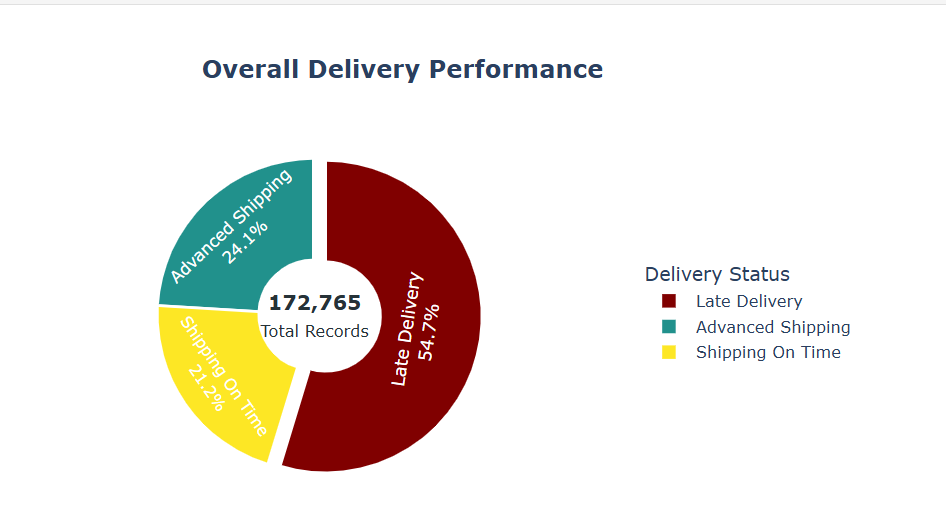

### Finding 2: The premium shipping modes are the ones failing their promise

| Shipping mode | Share of lines | Scheduled days | Actual days | Late orders |
|---|---|---|---|---|
| First Class | 15.3% | 1 | 2 | **100.00%** |
| Second Class | 19.6% | 2 | 4 | **79.99%** |
| Standard Class | 59.7% | 4 | 4 (range 2 to 6) | 39.85% |
| Same Day | 5.4% | 0 | 0 | 0.00% |

First Class is promised in 1 day and always takes 2. Second Class is promised in 2 days and averages 4. Standard Class meets its average promise but spreads from 2 to 6 days against a 4-day promise, which is why about 40% of its orders are late. Same Day never misses.

Overall, the average scheduled duration is 2.93 days against about 3.5 days actual, a gap of roughly 0.55 days.

**Visuals:** 
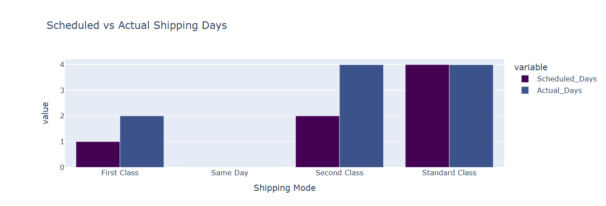    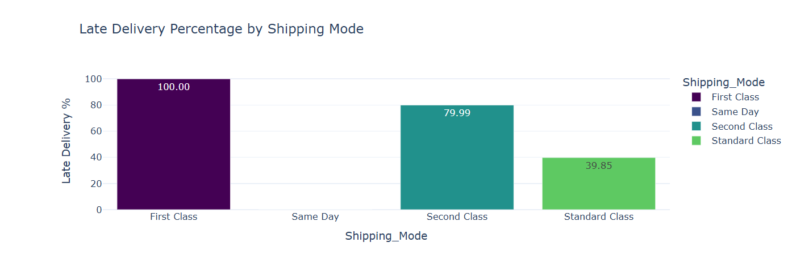

### Finding 3: Delay is systemic across the network, not regional

Late delivery % by region sits in a narrow band, from 50.83% (Canada) to 58.66% (Central Africa). Most regions are between 52% and 56%.

| Region group | Late delivery % |
|---|---|
| Highest | Central Africa 58.66%, Southeast Asia 55.97%, Eastern Europe 55.96%, South of USA 55.93% |
| Typical | Western Europe 55.79%, Central America 54.71%, Central Asia 54.06% |
| Lowest | Canada 50.83%, Southern Africa 52.27%, West Africa 52.48% |

The average-delay heatmap by region and mode shows the same story. Second Class averages roughly 1.9 to 2.2 days late in every region (highest in Central Asia at 2.22), First Class about 1 day late everywhere, and Same Day and Standard Class close to zero. The driver is the **shipping mode**, not the geography.

**Visuals:** 
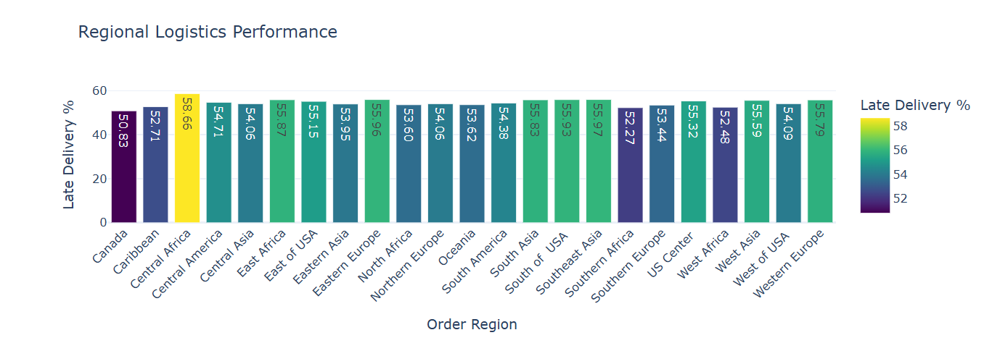  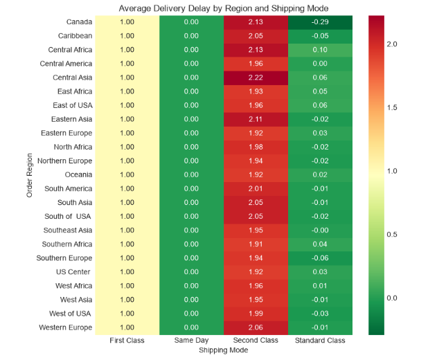

### Finding 4: Loss-making lines are spread evenly, and are not explained by shipping mode or discount

| Shipping mode | Loss-making lines | Loss rate (derived) |
|---|---|---|
| Standard Class | 19,439 | 18.8% |
| Second Class | 6,265 | 18.5% |
| First Class | 4,832 | 18.2% |
| Same Day | 1,759 | 18.9% |

- Loss rates are almost identical across modes, even though lateness ranges from 0% to 100%.
- Mean discount is 20.66 on loss lines and 20.68 on profitable lines. There is no gap.
- The correlation matrix agrees: discount rate versus profit is −0.02, and actual or scheduled shipping days versus profit are 0.00.
- Large categories all lose on about 18.6% to 18.9% of lines. The highest rates are in small categories: Men's Clothing 24.24% (198 lines), Health and Beauty 23.41% (346), Video Games 21.77% (804) and Golf Shoes 21.71% (502).
- The most loss-making lines by count are in the biggest categories: Cleats 4,389, Men's Footwear 3,993, Women's Apparel 3,745, Indoor/Outdoor Games 3,471 and Fishing 3,047.
- Profit per line is heavily skewed: mean 22.03, median 31.52, standard deviation 104.36, with a long negative tail down to −4,274.98.

**Interpretation.** On this data, late delivery and loss-making are two separate problems that both exist at scale. The data does **not** show that delays cause the losses. What drives the loss tail is still unexplained and needs cost-level detail.

**Visuals:** profit-per-order histogram with box plot; discount versus profit scatter; sales versus profit scatter by segment.

### Finding 5: Profit at Risk is large but mostly follows volume

**$4.11M, or 54.71% of all positive profit**, sits on delayed lines. By mode it is roughly $1.8M for Standard Class, and $1.2M each for Second Class and First Class. By region it is highest in Western Europe and Central America (about $0.65M each), then South America (about $0.33M). The ranking mirrors order volume, which fits the finding that delay is spread evenly.

Profit at Risk is an exposure measure (positive profit on late lines), not realised loss.

**Visuals:**
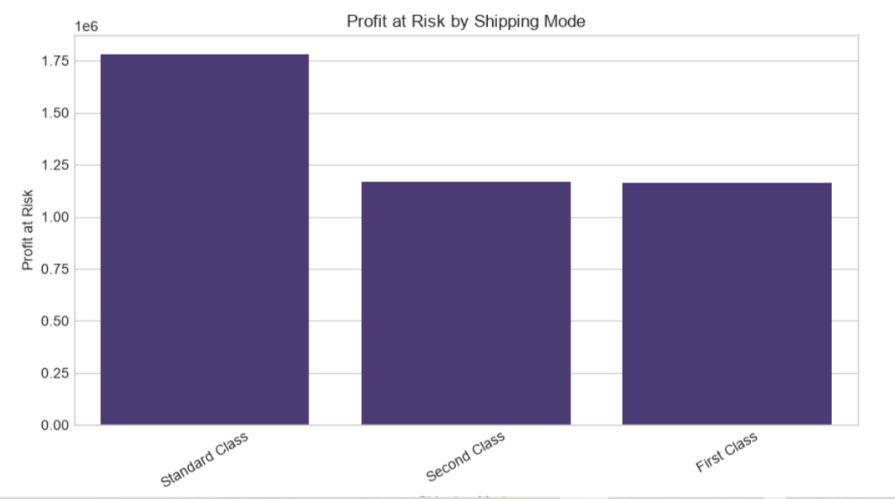 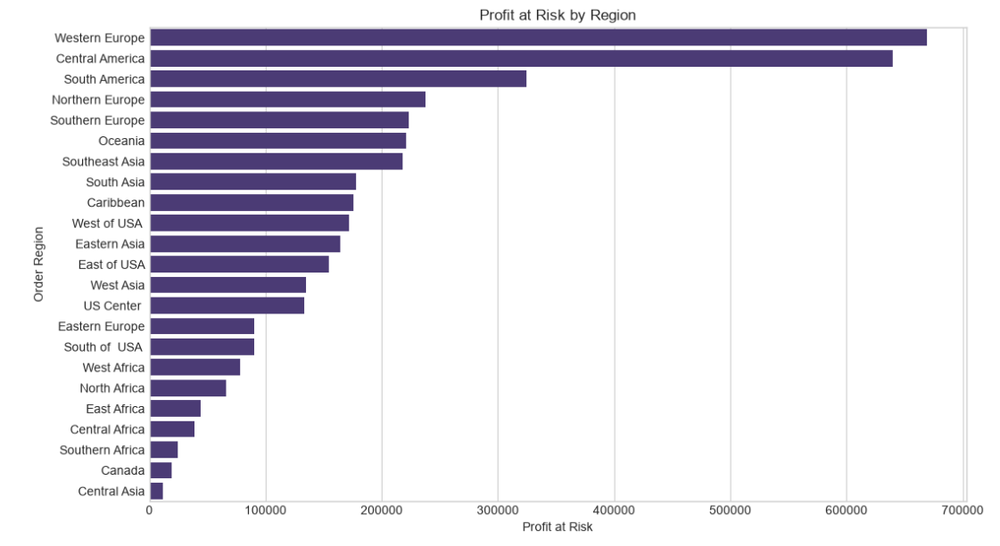


### Finding 6: Demand is concentrated in a few products and categories

| Rank | Product | Units |
|---|---|---|
| 1 | Perfect Fitness Perfect Rip Deck | 70,575 |
| 2 | Nike Men's Dri-FIT Victory Golf Polo | 60,232 |
| 3 | O'Brien Men's Neoprene Life Vest | 55,333 |

| Rank | Category | Units | Revenue |
|---|---|---|---|
| 1 | Cleats | 70,611 | $3.82M |
| 2 | Women's Apparel | 60,232 | $2.71M |
| 3 | Indoor/Outdoor Games | 55,333 | $2.49M |
| 4 | Cardio Equipment | 35,937 | $3.17M |
| 5 | Shop By Sport | 31,329 | $1.13M |

- Revenue and volume do not line up. **Fishing** is the top revenue category ($5.96M) on only 16,595 units, while Cleats leads on volume.
- The lowest-demand products sell between 8 and 33 units: Bushnell Pro X7 Jolt Slope Rangefinder (8), Bowflex SelectTech 1090 Dumbbells (10), SOLE E25 Elliptical (10), SOLE E35 Elliptical (15).
- Splitting the 118 products into thirds by quantity gives 33.1% fast, 33.1% medium and 33.9% slow. This is a relative ranking by construction, not evidence of balanced inventory.
- 54.9% of lines are single-unit purchases.

**Visuals:** 
 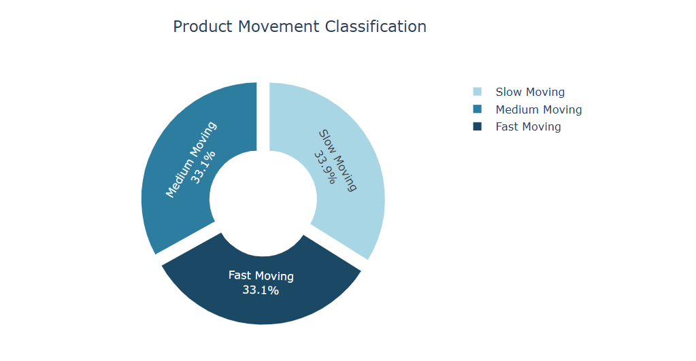
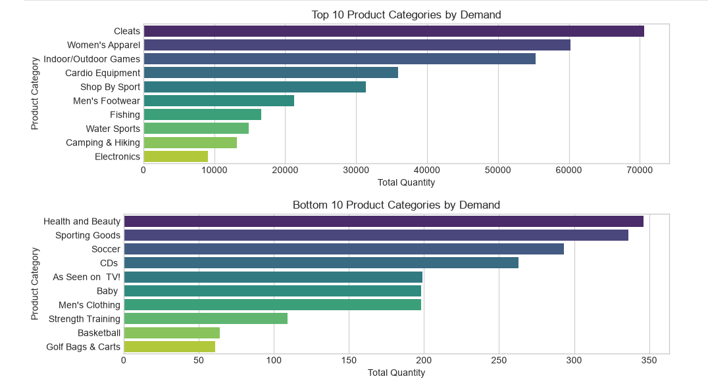   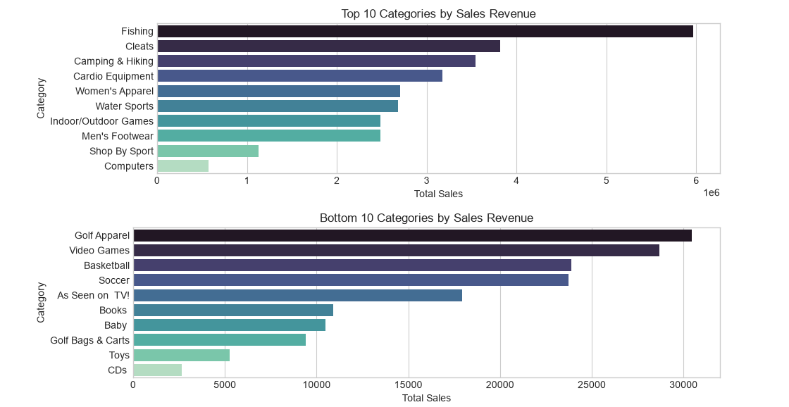  
 
### Finding 7: Demand is geographically concentrated

| Market | Share of units |
|---|---|
| LATAM | 29.4% |
| Europe | 27.4% |
| Pacific Asia | 21.9% |
| USCA | 14.7% |
| Africa | 6.7% |

- Top regions: Central America (about 59.5k units), Western Europe (about 53.9k) and South America (about 31k). Central Asia is lowest (about 1.2k).
- Top countries by units: United States (about 52.0k), Mexico (27.5k), France (26.4k), Germany (19.0k), Brazil (16.5k), Australia (16.1k), United Kingdom (14.6k).
- By customer segment, Consumer is 51.8% of units (190,522), Corporate 30.4%, Home Office 17.8%.

**Visuals:** market donut; region and country bars; segment donut.
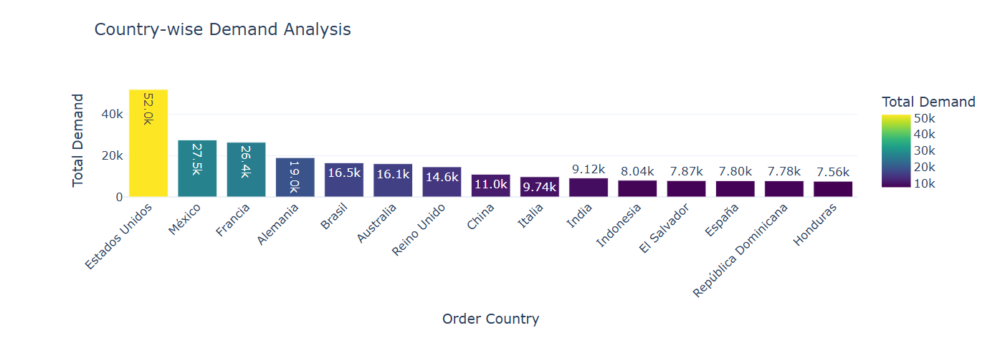    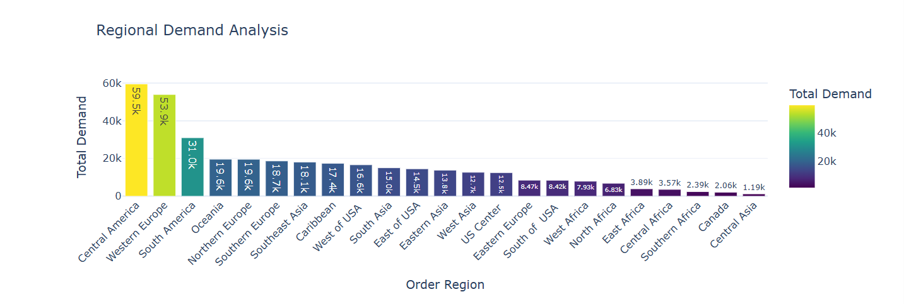 
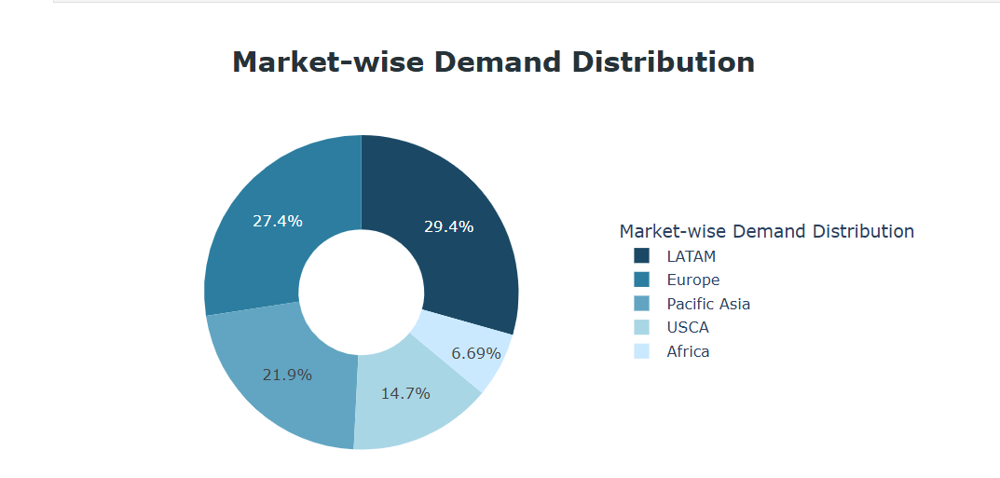    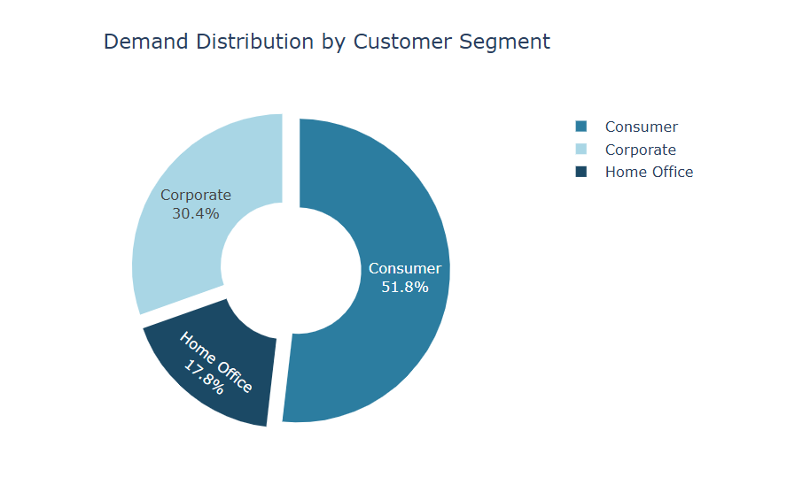
### Finding 8: Monthly demand is stable until a sharp drop in late 2017

Demand runs at about 10,000 to 11,500 units a month in 2015 and 2016, with no strong seasonality. In 2017 it follows the same pattern to September (about 9,900), then falls to roughly 2,000 to 2,400 units in October, November and December. January 2018 shows about 2,000 units and is the only 2018 month.

By year, order lines are 59,954 (2015), 59,926 (2016), 50,848 (2017) and 2,037 (2018). A drop this abrupt looks more like incomplete data capture than a business change, and needs confirming before any forecast is built.

**Visual:** 
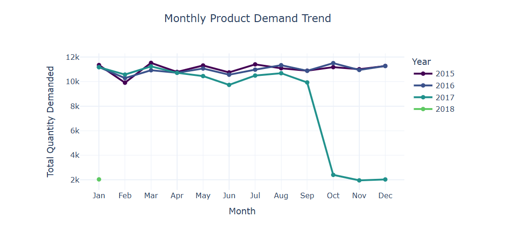  


### Finding 9: Correlation analysis

| Pair | r | Reading |
|---|---|---|
| Sales and Product Price | 0.79 | Price drives line sales |
| Order Quantity and Product Price | −0.48 | Dearer items are bought in smaller quantities |
| Actual and Scheduled Shipping Days | 0.53 | Longer promises take longer, as expected |
| Sales and Profit | 0.13 | Higher sales do not mean proportionally higher profit |
| Sales and Quantity | 0.11 | Weak |
| Discount Rate with every other variable | −0.02 to 0.00 | No linear relationship |
| Shipping days with Sales, Profit, Price | 0.00 to 0.01 | Logistics and financial performance move independently |

**Visual:**
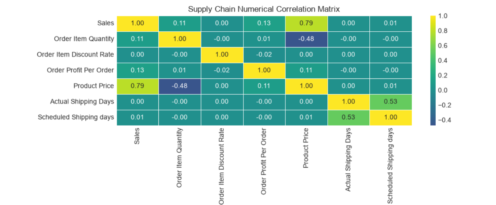
---

# 🔍 8. Key Analytical Findings

The following findings are based on the completed dataset analysis.

### Dataset Overview

- Original dataset contained 180,519 records.
- After cleaning and preprocessing, the dataset contained 172,765 records and 43 columns.
- The cleaned dataset contains 62,897 unique orders.

### Delivery Performance

- Approximately 54.7% of records were classified as late deliveries.
- This indicates a significant delivery performance concern that requires further investigation.
- Delivery performance can be examined across shipping modes, geographical regions, and order priorities.

### Profitability

- 32,295 records had negative order-level profit values.
- This highlights the presence of a considerable number of loss-making order-item records.
- Further analysis of discounts, product categories, customer segments, and shipping-related factors can help investigate profitability variations.

### Product Movement

- Products were classified into fast-, medium-, and slow-moving categories using historical quantity distribution.
- This classification helps identify differences in product demand and supports demand-based inventory planning.

**Important:** The above figures represent dataset-level observations. The loss-making record count is not necessarily the number of unique loss-making orders. Similarly, the late delivery percentage is based on the analyzed records and should not automatically be interpreted as a unique-order delivery rate.

---

# 💡 9.Business Recommendations

Based on the analytical areas and observed patterns, the following recommendations can support better supply chain operations.

### 1. Improve Demand Planning

Use historical product demand and sales trends to identify products with consistently high and low demand.

### 2. Implement Demand-Based Inventory Planning

Use fast-, medium-, and slow-moving product classifications to support inventory allocation and product replenishment decisions.

Actual stock optimization would require additional information such as current stock levels, lead times, and reorder points.

### 3. Improve Delivery Performance

Investigate the operational factors associated with late deliveries and review shipping mode performance to identify opportunities for improving order fulfillment.

### 4. Monitor Regional Logistics Performance

Identify geographical areas experiencing higher delivery delays and investigate possible transportation and fulfillment challenges.

### 5. Review Discount Strategies

Evaluate how discounts relate to order-level profitability and review promotional strategies that may contribute to negative profit.

### 6. Monitor Profitability

Track profit across product categories, customer segments, and markets to identify areas requiring financial improvement.

### 7. Establish Continuous Performance Monitoring

Monitor important KPIs such as sales, profit, demand, late delivery rate, and average shipping days to evaluate supply chain performance over time.

---


# 📉 10. Visualizations

## 📊  Power BI Dashboard

A Power BI dashboard is planned as a business intelligence presentation layer for communicating the results of the Python analysis.

### Proposed Dashboard Pages

**Page 1: Executive Overview**

KPIs:
- Total Sales
- Total Profit
- Total Orders
- Total Quantity
- Late Delivery Rate

Visualizations:
- Sales and profit trends.
- Sales by market.
- Profit by customer segment.
- Delivery status distribution.

**Page 2: Inventory and Demand Analysis**

Visualizations:
- Top 10 products by quantity.
- Fast-, medium-, and slow-moving product distribution.
- Category-wise demand.
- Market-wise demand.
- Product quantity trends.

**Page 3: Logistics and Delivery Performance**

Visualizations:
- Delivery status distribution.
- Late delivery rate by shipping mode.
- Average shipping days.
- Scheduled vs actual shipping days.
- Regional delivery performance.
- Delivery risk analysis.

**Page 4: Profitability Analysis**

Visualizations:
- Total profit and sales.
- Profit distribution.
- Profitable vs loss-making records.
- Profit by product category.
- Profit by customer segment.
- Discount vs profit analysis.
- Market-wise profitability.

The dashboard will help business stakeholders explore supply chain performance and understand the key factors affecting operational efficiency and profitability.

---

The proposed dashboard will provide an interactive overview of supply chain performance.

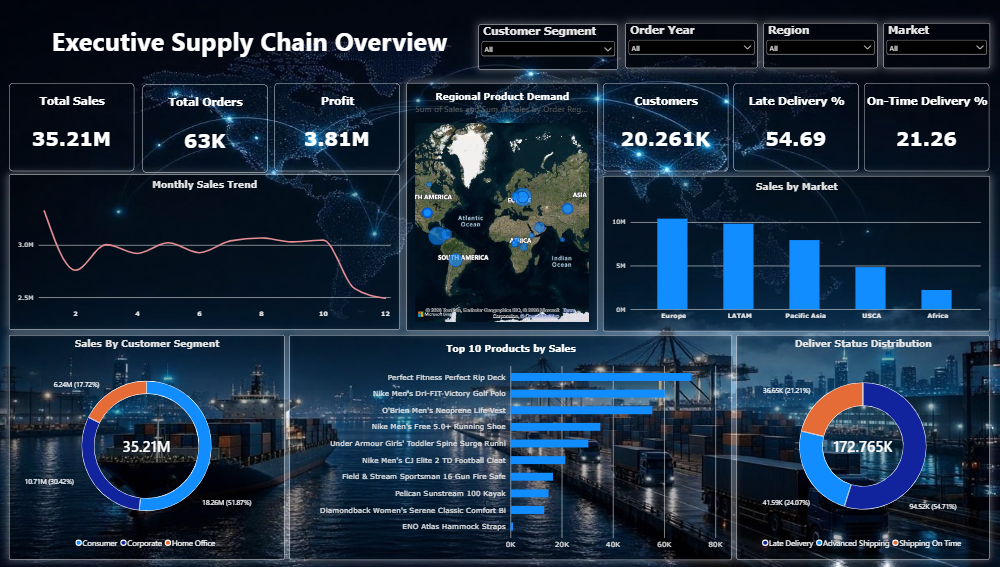

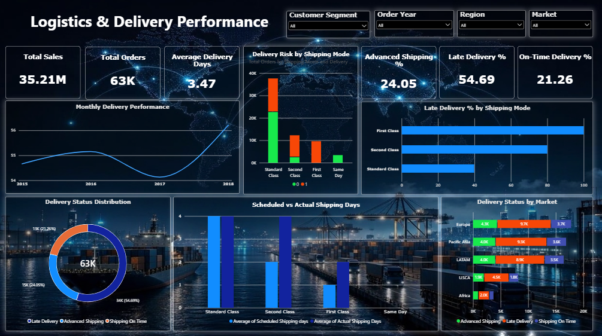


# ⚠️ 11. Limitations & Assumptions

## 1 Analytical Limitations

| # | Limitation | Effect on the findings |
|---|---|---|
| 1 | **No stock or replenishment data.** The file holds no warehouse balances, reorder points or stock-outs | "Inventory" analysis is movement of historical sales quantity, not true inventory turnover |
| 2 | **Demand equals fulfilled orders.** Lost sales and unmet demand are not recorded | Demand is likely understated for stocked-out items |
| 3 | **No cost structure.** Product cost, carrier cost, penalties and refunds are absent | Root causes of loss lines cannot be separated into pricing, cost or mix |
| 4 | **No carrier, warehouse or route fields** | Delay causes can be located (mode) but not explained |
| 5 | **Truncated final months.** October 2017 to January 2018 look incomplete | Trend and seasonality conclusions are unreliable for 2017 onward |
| 6 | **Association only.** Analysis is descriptive, with no hypothesis tests or models | No claim of cause can be made |
| 7 | **Scheduled days are a fixed promise per mode** (0, 1, 2 or 4 days) | Lateness largely reflects how the promise is set, not only how the network performs |
| 8 | **Whole-day shipping calculation** | About 2.6% of lines may sit one day off the supplied value |
| 9 | **Historical, single-company data (2015 to early 2018)** | May not reflect current operations |
| 10 | **Order-status mix.** About 54% of lines (93,658) are pending payment, pending, processing, on hold or in payment review, and only 59,491 are COMPLETE | Profit on
 non-completed orders may still change |

## 2 Key Assumptions

| # | Assumption |
|---|---|
| 1 | Each row is one order line and is treated as an independent record for totals |
| 2 | `Order Profit Per Order` is correct as recorded |
| 3 | Quantity sold is a valid proxy for demand |
| 4 | An order is "late" if any of its lines has actual days above scheduled days |
| 5 | Shipping canceled rows carry no delivery performance and can be excluded |
| 6 | A line is "loss-making" when profit is below zero; zero profit is break-even |
| 7 | Fast, medium and slow movers are equal-sized thirds of products ranked by units |
| 8 | Delay and profit are compared as associations; no causal assumption is made |
| 9 | Dollar values are in the dataset's currency units (shown as $) |

---

# 🚀 12. Suggestions for Future Work


- Add cost, carrier and warehouse fields so that loss and delay causes can be separated.
- Test the delay and profit relationship with a statistical test and a regression or tree model.
- Build a delay prediction model using mode, region, product and order timing.
- Add a demand forecast once the late-2017 gap is resolved.
- Extend inventory analysis with stock levels, lead times and reorder points.

---


## 📁 13. GitHub Repository Structure

The repository can be organized as follows:

```text
supply-chain-analytics/
DataCo_SMART_Supply_Chain/
│
├── data/
│   └── DataCoSupplyChainDataset.csv
│   └── tokenized_access_logs.csv
│   └── README.md
├── notebooks/
│   ├── Project_proposal_phase1.ipynb
├── Supply_Chain_Analytics_SRS_5_Pages
└── README.md
```

### Folder Descriptions

* `data/` — Local dataset storage. The raw dataset does not need to be committed to GitHub.
* `notebooks/` — Jupyter Notebooks containing the analytical workflow.
* `outputs/charts/` — Selected visualizations generated during analysis.
* `outputs/summary_tables/` — Exported analytical summaries, where useful.
* `README.md` — Project overview, setup instructions, workflow, and findings.
* `requirements.txt` — Python dependencies required to reproduce the analysis.

**Data handling:** Review the dataset's license, terms, size, and privacy considerations before sharing any source or processed data publicly. If the dataset should not be redistributed, provide instructions for obtaining it from the original source instead.

## ⚙️ 14. Installation and Setup

### Prerequisites

Install the following:

* Python 3.x
* Jupyter Notebook or JupyterLab
* Git, if you plan to clone the repository

### Step 1: Clone the Repository

```bash
git clone <https://github.com/SiniyaVH/Supply_Chain_Analytics/DataCo_SMART_Supply_Chain>
```

### Step 2: Navigate to the Project Folder

```bash
cd supply-chain-analytics
```

### Step 4: Install Dependencies

Create a file containing:

```text
pandas
numpy
matplotlib
seaborn
jupyter
```

Install the libraries:

```bash
pip install -r https://github.com/SiniyaVH/Supply_Chain_Analytics/tree/main/DataCo_SMART_Supply_Chain
```

### Step 5: Download the Dataset

Obtain the DataCo SMART Supply Chain dataset from the original Mendeley Data source:

https://data.mendeley.com/datasets/8gx2fvg2k6/5

Place the downloaded file in the appropriate local data folder, following the path expected by your notebook.

Update the notebook's file path to match the actual filename and location.

### Step 6: Launch Jupyter Notebook

```bash
jupyter notebook
```

Open the notebooks in numerical order and execute the cells from top to bottom.

**Note:** The exact filename and file format must be verified after downloading the dataset. Update the loading code accordingly.


## 👩‍💻 15. Skills Demonstrated

This project is intended to demonstrate the following Data Analyst skills:

* Python programming
* Pandas data manipulation
* NumPy numerical operations
* Data cleaning and preprocessing
* Data quality assessment
* Feature engineering
* Exploratory Data Analysis (EDA)
* Descriptive and statistical analysis
* Data visualization using Matplotlib and Seaborn
* Business question formulation
* Analytical interpretation and reporting
* GitHub project documentation

## 📚 16. References

**Dataset:** DataCo SMART Supply Chain for Big Data Analysis

**Source:** Mendeley Data

**Dataset page:**
https://data.mendeley.com/datasets/8gx2fvg2k6/5

---

# 🎓 17. Conclusion

The DataCo data describes a business with strong, stable demand and healthy gross volume ($35.2M sales, $3.8M net profit) but a serious service problem: 54.69% of orders are delivered later than promised. The failure is concentrated in the premium services. First Class and Second Class miss their promise on 100% and 80% of orders, and Standard Class misses on about 40% because its delivery times are too variable. Because the pattern is the same in every region, the fix belongs in shipping-mode operations and promise setting.

Loss-making is a separate, equally large issue. Roughly one line in five loses money, at a nearly identical rate across shipping modes and categories, and discount and shipping time show no relationship with profit. The notebook therefore supports the business problem as two parallel inefficiencies, delivery performance and transaction profitability, and does not prove that one causes the other.

The most valuable next step is better data: cost, carrier and stock fields, and a clean 2017 to 2018 record. With those, the project can move from describing where the problems are to explaining and predicting them.

---
# Validation Notes on the Notebook

While preparing this report, the notebook's written commentary was compared with its computed outputs. Please review these items, because several are visible in the notebook narrative.

| # | Notebook commentary | Computed output | Used in this report |
|---|---|---|---|
| 1 | "172,765 orders" | 172,765 is the **line** count; unique orders are 62,897 | 62,897 orders, 172,765 lines |
| 2 | "Total profit $7.5M, 21.3% of sales" | $7.5M is positive profit only; losses are $3.7M and net profit is $3.8M | Net profit $3.8M (about 10.8%) |
| 3 | "32,295 loss-making records, roughly 18.7% of total orders" | 32,295 is lines (18.69%); loss-making **orders** are 4,401 | Both, labelled correctly |
| 4 | "$2.1M in losses due to delays" | No cell computes this figure; Profit at Risk is $4.11M of positive profit | Not used |
| 5 | Delivery risk "276.1% / 220.19% / 109.01%" | Late lines divided by unique orders, so values above 100% are not valid percentages | Order-level late % (100.00 / 79.99 / 39.85 / 0.00) |
| 6 | Regional "variance" 0.42 to 0.62 | The chart shows late % from 50.83 to 58.66 | Chart values |
| 7 | Top product "about 76.6k units" | Computed 70,575 units | 70,575 |
| 8 | Country chart described as "sales exceeding 4.5M" | The chart plots demand in units (United States about 52.0k) | Units |
| 9 | "Delay losses are about 28% of profit" | Depends on the unsupported $2.1M figure | Not used |
| 10 | The notebook framing that discounts or shipping drive loss lines | Loss rate is flat across modes; mean discount is equal on loss and profit lines | Reported as no observed relationship |

-----
## 👩‍💻 Author

**Siniya V.H**

Aspiring Data Analyst | Python | SQL | Power BI | Data Visualization

- LinkedIn: [linkedin.com/in/siniya-v-h](https://www.linkedin.com/in/siniya-v-h)
- GitHub: [Add your GitHub profile link]

---

⭐ If you find this project interesting, consider giving the repository a star!

