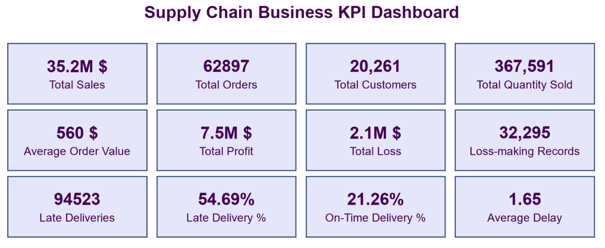
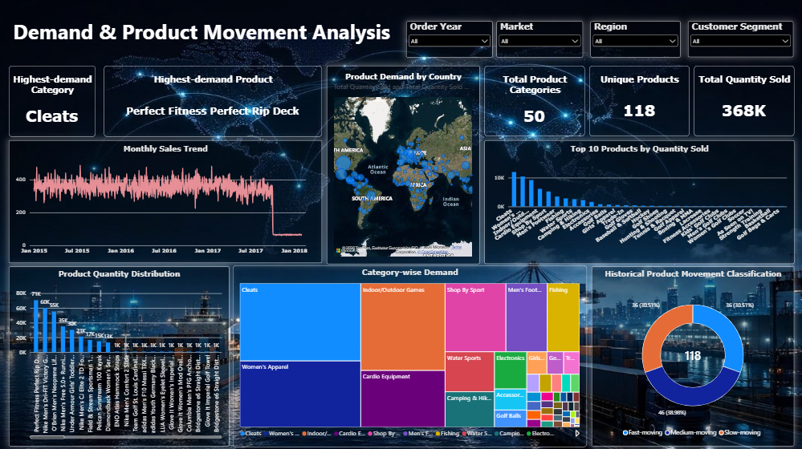
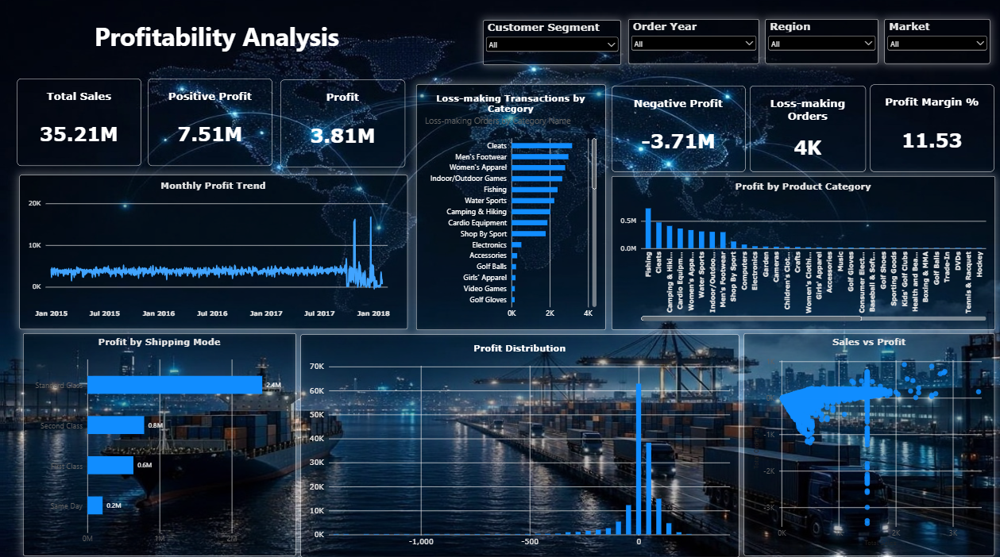

# 📦 Supply Chain Analytics Using Python

### Inventory, Logistics Performance, and Demand Analysis


**Project Type:** Data Analytics Portfolio Project
**Domain:** Supply Chain & Logistics Analytics
**Programming Language:** Python
**Dataset:** DataCo SMART Supply Chain
**Project Date:** October 2026

---


## 📌 1. Project Overview

Supply chain management plays an important role in ensuring that products move efficiently from manufacturers and warehouses to customers. Effective supply chain operations require proper demand planning, inventory management, order fulfillment, logistics coordination, and financial performance monitoring.

This project, **Supply Chain Analytics Using Python**, focuses on analyzing the DataCo SMART Supply Chain dataset to identify operational inefficiencies, understand customer demand, evaluate product movement, investigate delivery performance, and assess order-level profitability.

The project uses Python-based data analytics techniques to transform raw transactional data into meaningful business insights.

The analysis covers four major areas:

- **Inventory Management:** Understanding product movement and identifying fast-, medium-, and slow-moving products using historical demand.
- **Demand Analysis:** Examining product demand, sales patterns, customer segments, geographical demand, and order trends.
- **Logistics Optimization:** Investigating delivery delays, shipping performance, delivery risk, and order fulfillment efficiency.
- **Profitability Analysis:** Evaluating profit distribution, loss-making transactions, discount impact, and profitability across different business segments.

The ultimate goal is to identify the factors affecting supply chain efficiency and profitability and provide data-driven recommendations for improving business operations.

---

## 🎯 2. Business Problem

The primary business problem is poor supply chain and delivery performance, which is causing substantial profit leakage despite strong sales and customer demand.
The company has strong market demand but suffers from severe order fulfilment and logistics inefficiencies, leading to excessive delivery delays, financial losses, and a high number of loss-making transactions.
Despite generating substantial sales revenue, the business faces challenges in maintaining delivery commitments, managing product demand efficiently, and ensuring that transactions remain profitable.
These challenges highlight the need for a comprehensive analysis of supply chain operations to identify the underlying factors affecting operational efficiency and financial performance.
The major business concerns include:

1. **Delivery Delays:** A significant proportion of orders experience late delivery, indicating potential inefficiencies in logistics and order fulfillment.

2. **Product Movement:** Different products have different demand patterns. Understanding fast-, medium-, and slow-moving products is important for effective inventory planning.

3. **Demand Variations:** Product demand varies across categories, customer segments, markets, and geographical regions.

4. **Profitability Issues:** Despite generating sales, the company experiences loss-making transactions, suggesting that discounts, shipping expenses, and other order-level factors may affect profitability.

5. **Logistics Performance:** Shipping modes, scheduled delivery days, actual shipping days, and delivery risks influence the overall customer fulfillment experience.

### Analytical Objectives

The primary Analytical objective is to identify the key factors contributing to supply chain inefficiencies, delivery delays, and profit losses by analysing sales, demand, inventory, order fulfilment, and logistics performance.

#### Specific Analytical Objectives:

    1. Evaluate Supply Chain Profitability: Analyse sales, profit distribution, loss-making transactions, and category-level profitability to understand financial                performance.
    
    2. Analyse Product Demand: Identify high-demand and low-demand products, category-level purchasing patterns, and geographical demand variations.
    
    3. Evaluate Inventory Movement: Classify products into fast-moving, medium-moving, and slow-moving categories to support better inventory planning.
    
    4. Assess Logistics Performance: Investigate delivery delays, shipping methods, scheduled versus actual shipping durations, and regional delivery performance.
    
    5. Identify Operational Bottlenecks: Examine order fulfilment and delivery patterns to identify areas requiring operational improvements.
    
    6. Develop Business Recommendations: Translate analytical findings into practical recommendations for improving inventory efficiency, logistics reliability, and              profitability.

---

## 🎯 3. Project Objectives

The primary objectives of this project are:

- Analyze historical sales and product demand patterns.
- Identify high-demand and low-demand products.
- Classify products based on their movement as fast-, medium-, and slow-moving.
- Understand demand distribution across product categories, markets, and geographical regions.
- Evaluate delivery performance and identify factors associated with late deliveries.
- Analyze shipping modes and their relationship with delivery performance.
- Investigate the distribution of profit and identify loss-making transactions.
- Examine the relationship between discounts, sales, and profitability.
- Identify operational inefficiencies and potential areas for improvement.
- Develop data-driven business recommendations.

---

## 📂 4. Dataset Information

**Dataset Name:** DataCo SMART Supply Chain for Big Data Analysis

**Source:** Mendeley Data

**Dataset Link:**
https://data.mendeley.com/datasets/8gx2fvg2k6/5

The dataset is intended to support analysis of supply chain and transactional operations. The exact structure, column definitions, and available measures will be verified after downloading the selected dataset version.

### Dataset Information to Document
**Original Dataset Size:**
- Total Records: 180,519
- Contains customer, order, product, sales, shipping, delivery, and financial information.


| Attribute         | Description                                                                          |
| ----------------- | ------------------------------------------------------------------------------------ |
| Dataset name      | DataCo SMART Supply Chain                                                            |
| Source            | Mendeley Data                                                                        |
| File format       | csv                                                                                  |
| Number of rows    | 180519                                                                               |
| Number of columns | 53                                                                                   |
| Data types        | int64, Str, float64                                                                  |              
| Domain            | Supply Chain                                                                         |

**Cleaned Dataset Size:**
- Total Records: 172,765
- Total Columns: 43
### Important Dataset Attributes

| Category | Important Columns |
|---|---|
| Order Information | Order Id, Order Date, Order Status |
| Customer Information | Customer Id, Customer Segment, Customer City, Customer Country |
| Product Information | Product Id, Product Name, Category Name |
| Demand Information | Order Item Quantity |
| Sales Information | Sales, Order Item Total |
| Profitability | Order Profit Per Order |
| Discount | Order Item Discount, Order Item Discount Rate |
| Shipping | Shipping Mode, Days for Shipping (Scheduled) |
| Delivery | Days for Shipping (Real), Delivery Status, Late Delivery Risk |
| Geographical Information | Market, Order Region, Order Country |

The dataset contains historical transactional information that allows the analysis of customer demand, product movement, delivery operations, and financial performance.

---

## 🛠️ 5. Technologies and Tools Used

The project uses Python and its data analytics ecosystem.

| Technology | Purpose |
|---|---|
| Python | Main programming language |
| Jupyter Notebook | Development and analysis environment |
| Pandas | Data manipulation, cleaning, and aggregation |
| NumPy | Numerical calculations and feature engineering |
| Matplotlib | Statistical and exploratory visualizations |
| Seaborn | Statistical data visualization |
| Plotly | Interactive data visualizations |
| Power BI | Planned business intelligence dashboard |

**Note:** The core data cleaning, analysis, calculations, and exploratory visualizations are performed using Python. Power BI is intended for the separate dashboard presentation layer.

---
The project focused on:

* Data cleaning and preprocessing
* Feature engineering
* Exploratory Data Analysis
* Descriptive and statistical analysis
* Data visualization
* Business insights and recommendations

Machine learning and predictive demand forecasting are outside the core project scope.

## 🔄 6. Project Workflow

The project follows these analytical stages.

### Step 6.1: Data Loading

* Import the required Python libraries.
* Load the downloaded dataset into a Pandas DataFrame.
* Verify that the file has loaded correctly.
* Prepared SRS.

### Step 6.2: Data Cleaning, Preprocessing and Feature Engineering

The following steps were performed using Python, Pandas and NumPy to clean and prepare the DataCo SMART Supply Chain dataset.

#### 1. Import Libraries and Load Dataset

```python
import pandas as pd
import numpy as np

df = pd.read_csv(
    "DataCoSupplyChainDataset.csv",
    encoding="latin1"
)
```

#### 2. Initial Dataset Inspection

Inspected the dataset to understand its structure, dimensions, data types and statistical information.

```python
df.head()
df.shape
df.info()
df.describe(include="all").T
df.nunique()
```

#### 3. Missing Value Analysis

Identified missing values and calculated their percentage in each column.

```python
df.isnull().sum()

missing_percentage = (df.isnull().sum() / len(df)) * 100

print(missing_percentage)
```

Columns identified for removal included:

* Customer Zipcode
* Order Zipcode
* Product Description

#### 4. Duplicate Column Identification

Compared columns to identify identical data.

```python
duplicate_columns = df.columns[df.T.duplicated()].tolist()

print("Duplicate columns:", duplicate_columns)

df.drop(columns=duplicate_columns, inplace=True)
```

#### 5. Removing Unnecessary Columns

Removed irrelevant columns that were not required for the planned analysis.

```python
col_drop = [
    "Customer Password",
    "Customer Zipcode",
    "Order Zipcode",
    "Product Description",
    "Product Image"
]

existing_columns = [col for col in col_drop if col in df.columns]

df.drop(columns=existing_columns, inplace=True, errors="ignore")

print("Columns dropped:", existing_columns)
```

#### 6. Customer Name Creation

Combined customer first name and last name into a single column.

```python
df["Customer Name"] = df["Customer Fname"] + " " + df["Customer Lname"]

df.drop(
    columns=["Customer Fname", "Customer Lname"],
    inplace=True,
    errors="ignore"
)
```

#### 7. DateTime Conversion

Converted order date and shipping date columns into Pandas datetime format.

```python
date_columns = [
    "shipping date (DateOrders)",
    "order date (DateOrders)"
]

for col in date_columns:
    df[col] = pd.to_datetime(df[col], errors="coerce")
```

#### 8. Actual Shipping Days Calculation

Created a new column to calculate the actual number of calendar days between order placement and shipping.

```python
df["Actual_Shipping_Days"] = (
    df["shipping date (DateOrders)"] -
    df["order date (DateOrders)"]
).dt.days
```

Compared the newly calculated values with the existing shipping-days column.

```python
df["Actual_Shipping_Days"].equals(
    df["Days for shipping (real)"]
)
```

Removed the original column after comparison.

```python
df.drop(
    columns=["Days for shipping (real)"],
    inplace=True,
    errors="ignore"
)
```

#### 9. Removing Cancelled Shipping Records

Removed records with the delivery status `Shipping canceled`.

```python
cancelled_rows = (
    df["Delivery Status"].str.strip().str.lower()
    == "shipping canceled"
).sum()

df = df[
    df["Delivery Status"].str.strip().str.lower()
    != "shipping canceled"
]

print("Cancelled rows deleted:", cancelled_rows)
print("Remaining rows:", len(df))
```

#### 10. Delivery Status Classification

Created a new `Delivery_Status` column by comparing actual shipping days with scheduled shipping days.

```python
conditions = [
    df["Days for shipment (scheduled)"] > df["Actual_Shipping_Days"],

    df["Days for shipment (scheduled)"] < df["Actual_Shipping_Days"],

    df["Days for shipment (scheduled)"] == df["Actual_Shipping_Days"]
]

status = [
    "Advanced Shipping",
    "Late Delivery",
    "Shipping On Time"
]

df["Delivery_Status"] = np.select(
    conditions,
    status,
    default="Unknown"
)
```

Compared the newly created delivery-status column with the original delivery-status column.

```python
df["Delivery_Status"].equals(df["Delivery Status"])
```

Removed the original delivery-status column.

```python
df.drop(
    columns=["Delivery Status"],
    inplace=True,
    errors="ignore"
)
```

#### 11. Delivery Risk Flag Creation

Created a binary delivery-risk indicator based on the newly classified delivery status.

* 1 – Late Delivery
* 0 – Not Late Delivery

```python
df["delivery_risk"] = np.where(
    df["Delivery_Status"] == "Late Delivery",
    1,
    0
)
```

#### 12. Final Dataset Inspection

Inspected the final dataset to verify the updated columns and data types.

```python
df.info()

df.head()

df.shape
```
|   Column                          | dtype                                            |
| --------------------------------- | ------------------------------------------------ |
| Type                              |          str                                     |
| Days for shipment (scheduled)     |        int64                                     |
| Category Name                     |          str                                     |
| Customer City                     |          str                                     |
| Customer Country                  |          str                                     |
| Customer Segment                  |          str                                     |
| Customer State                    |          str                                     |
| Customer Street                   |          str                                     |
| Department Id                     |        int64                                     |
| Department Name                   |          str                                     |
| Latitude                          |      float64                                     |
| Longitude                         |      float64                                     |
| Market                            |          str                                     |
| Order City                        |          str                                     |
| Order Country                     |          str                                     |
| Order Customer Id                 |        int64                                     |
| Order date                        |    datetime64[us]                                |
| Order Id                          |        int64                                     |
| Order Item Discount               |      float64                                     |
| Order Item Discount Rate          |      float64                                     |
| Order Item Id                     |        int64                                     |
| Order Item Profit Ratio           |      float64                                     |
| Order Item Quantity               |        int64                                     |
| Sales                             |      float64                                     |
| Order Item Total                  |      float64                                     |
| Order Profit Per Order            |      float64                                     |
| Order Region                      |          str                                     |
| Order State                       |          str                                     |
| Order Status                      |          str                                     |
| Product Card Id                   |        int64                                     |
| Product Category Id               |        int64                                     |
| Product Name                      |          str                                     |
| Product Price                     |      float64                                     |
| Product Status                    |        int64                                     |
| shipping date                     |    datetime64[us]                                |
| Shipping Mode                     |          str                                     |
| Customer Name                     |          str                                     |
|Actual Shipping Days               |       int64                                      |
| Delivery Status                   |          str                                     |
| delivery Risk                     |        int64                                     |                                       
|  Order Year                       |        int64                                     | 
|  Order Month                      |        int64                                     | 
| Month_Name                        |         str                                      | 
|  Order Day                        |         str                                      | 
|  Order Hour                       |        int64                                     | 
|  Delay                            |         int64                                    | 
|  Is delay                         |         bool                                     | 
|  Profitability                    |         str                                      | 
---
**Dataset Transformation:**

| Description | Records | Columns |
|---|---:|---:|
| Original Dataset | 180,519 | Original structure |
| Cleaned Dataset | 172,765 | 43 |

**Preprocessing Status:** Completed

The dataset has undergone initial inspection, missing-value assessment, column removal, date conversion, feature creation, cancelled-record removal and delivery-status classification.

### Phase 6: Advanced Business Analysis

The cleaned dataset was used to perform four major analytical investigations:

1. Inventory Management and Product Movement
2. Demand Analysis
3. Logistics and Delivery Performance
4. Profitability Analysis

### 6.3 Data Visualization

Matplotlib, Seaborn, and Plotly were used to create visualizations that help communicate business patterns and analytical findings.

### 6.4 Business Insights and Recommendations

The final phase focuses on interpreting analytical results and translating them into meaningful business recommendations.

---


# 📊 7. Exploratory Data Analysis

EDA helps understand the overall characteristics of the dataset and identify important patterns before performing deeper business analysis.

## 📈 Key Supply Chain Metrics

The following metrics will be calculated where the necessary fields are available.

| Metric                    | Definition                                                                             | Purpose                            |
| ------------------------- | -------------------------------------------------------------------------------------- | ---------------------------------- |
| Total order records       | Number of valid transaction records                                                    | Understand dataset volume          |
| Unique orders             | Number of distinct order identifiers                                                   | Measure distinct orders            |
| Total sales               | Sum of the validated sales field                                                       | Assess recorded sales              |
| Total order quantity      | Sum of recorded order quantities                                                       | Understand recorded unit volume    |
| Average shipping duration | Average of valid actual shipping durations                                             | Examine shipping performance       |
| Average shipping delay    | Average difference between actual and scheduled shipping duration                      | Investigate shipping delays        |
| On-Time Delivery (OTD) %  | Eligible on-time deliveries divided by total eligible deliveries, multiplied by 100    | Measure delivery performance       |
| Late-delivery rate        | Eligible orders classified as late divided by total eligible orders, multiplied by 100 | Examine late-delivery outcomes     |
| Average sales per order   | Validated sales total divided by distinct orders                                       | Understand average sales per order |
| Average daily demand      | Recorded units over the analysis period divided by the number of calendar days         | Estimate recorded demand over time |




### Metric Validation

Metrics will be calculated only after checking the relevant fields, definitions, and aggregation levels.

For example, if an order contains multiple transaction rows, counting rows as unique orders or summing repeated order-level values may produce misleading results.

Similarly, a source-provided late-delivery-risk label will not automatically be treated as evidence that a delivery was actually late.

###  Univariate Analysis

Univariate analysis examines individual variables independently.

The following variables were explored:

- Sales distribution
- Profit per order distribution
- Product quantity distribution
- Order quantity distribution
- Customer segment distribution
- Shipping mode distribution
- Order status distribution
- Delivery status distribution

**Visualizations:**
- Histograms
- Box plots
- Count plots
- Distribution plots
- Bar charts

### Bivariate Analysis &  Multivariate Analysis

Bivariate analysis examines relationships between two variables.
Multivariate analysis examines multiple variables simultaneously to understand more complex business relationships.

The following relationships were investigated:

| Analysis | Business Purpose |
|---|---|
| Sales vs Customer Segment | Understand sales contribution by customer segment |
| Profit vs Product Category | Identify profitable and loss-making categories |
| Shipping Mode vs Delivery Status | Compare delivery performance across shipping modes |
| Discount vs Profit | Examine the relationship between discounts and profitability |
| Quantity vs Product Category | Understand product demand across categories |
| Market vs Sales | Compare sales performance across markets |
| Delivery Risk vs Delivery Status | Understand the relationship between delivery risk and actual delivery outcomes |

- Correlation between numerical variables.
- Relationship between shipping performance and delivery risk.
- Product demand across different markets and categories.
- Profitability across customer segments and regions.
- Comparison of shipping modes and delivery performance.

---

# 📦  Inventory Management and Product Movement Analysis

Inventory management is important for maintaining product availability while avoiding unnecessary inventory holding costs.

This project uses historical product demand to understand product movement patterns.

Since the dataset primarily contains transactional information rather than actual warehouse stock levels, inventory analysis focuses on historical demand and product movement instead of calculating actual stock availability or reorder quantities.

### Key Analytical Areas

**1. Product Quantity Analysis**

Analyze the total quantity ordered for each product to identify high-demand and low-demand products.

**2. Product Movement Classification**

Products are classified into three categories based on their total historical quantity sold.

| Product Movement | Description |
|---|---|
| Fast-Moving | Products with relatively high demand |
| Medium-Moving | Products with moderate demand |
| Slow-Moving | Products with relatively low demand |

Classification is based on demand distribution and selected quantity thresholds.

**3. Category-Wise Product Demand**

Understand which product categories contribute the highest demand.

**4. Product-Wise Order Analysis**

Identify products with the highest number of orders and highest quantity sold.

**5. Product Demand and Sales Contribution**

Compare product quantity with sales contribution to understand the relationship between product demand and revenue generation.

### Business Value

- Identify products with high historical demand.
- Understand slow-moving product patterns.
- Support demand-based inventory planning.
- Improve product assortment decisions.
- Reduce the risk of excessive inventory accumulation.

---

# 📈  Demand Analysis

Demand analysis helps businesses understand customer purchasing behavior and identify variations in product demand.

This section investigates historical sales and quantity patterns across different dimensions.

### Key Analytical Areas

**1. Overall Demand Analysis**

- Total order quantity.
- Average order quantity.
- Product demand distribution.
- Order volume trends.

**2. Product-Wise Demand**

- Highest-demand products.
- Lowest-demand products.
- Total quantity sold by product.
- Number of orders by product.

**3. Category-Wise Demand**

- Total quantity by product category.
- Category contribution to overall demand.
- Comparison of demand across categories.

**4. Geographical Demand Analysis**

- Country-wise demand.
- Market-wise demand.
- Region-wise order quantity.
- Customer demand distribution across geographical locations.

**5. Customer Segment Analysis**

- Sales contribution by customer segment.
- Order quantity by customer segment.
- Purchasing patterns across customer groups.

### Business Value

- Understand customer purchasing patterns.
- Identify high-demand product categories.
- Recognize geographical demand variations.
- Support demand planning and product allocation.
- Improve future demand planning decisions.

---

# 🚚  Logistics Optimization and Delivery Performance Analysis

Logistics performance directly affects customer satisfaction, order fulfillment, and operational efficiency.

This analysis focuses on understanding delivery performance and identifying factors associated with late shipments.

### Key Analytical Areas

**1. Delivery Status Analysis**

Examine the distribution of:

- Late Delivery
- Shipping On Time
- Advance Shipping

Understand the overall delivery performance of the company.

**2. Late Delivery Analysis**

Calculate the percentage of orders delivered late.

Formula:

Late Delivery Rate = (Late Delivered Orders / Total Relevant Delivered Orders) × 100

**3. Shipping Mode Analysis**

Compare delivery performance across different shipping modes.

Examples:

- First Class
- Second Class
- Standard Class
- Same Day

**4. Scheduled vs Actual Shipping Days**

Compare the expected shipping duration with actual shipping duration to understand delivery performance.

**5. Delivery Risk Analysis**

Examine the relationship between delivery risk indicators and actual delivery status.

**6. Regional Delivery Analysis**

Identify geographical areas with relatively higher delivery delays.

**7. Shipping Priority Analysis**

Investigate the relationship between order priority and delivery performance.

### Business Value

- Identify delivery performance issues.
- Understand shipping mode performance.
- Recognize regions experiencing delivery delays.
- Support better logistics planning.
- Improve order fulfillment efficiency.
- Reduce potential customer dissatisfaction.

---

# 💰  Profitability Analysis

Profitability analysis evaluates how effectively the company converts its sales into profit.

High sales do not necessarily indicate strong financial performance. Therefore, this analysis focuses on understanding the factors that may contribute to profit generation and financial losses.

### Key Analytical Areas

**1. Overall Sales and Profit Analysis**

- Total sales.
- Total profit.
- Average profit per order.
- Profit distribution.

**2. Profit Distribution Analysis**

Examine the distribution of profit per order using histograms and box plots.

Identify:

- Profitable transactions.
- Loss-making transactions.
- Extreme profit and loss values.
- Overall profit distribution.

**3. Loss-Making Transaction Analysis**

Identify transactions with negative profit and investigate their distribution across different business dimensions.

**4. Category-Wise Profitability**

Compare profit contribution across product categories.

**5. Customer Segment Profitability**

Understand which customer segments contribute positively or negatively to profitability.

**6. Market-Wise Profitability**

Compare profitability across different markets and geographical regions.

**7. Discount Impact Analysis**

Investigate the relationship between discounts and profit to understand whether higher discounts are associated with lower profitability.

**8. Shipping and Profitability**

Explore the relationship between shipping-related factors and order-level profit.

### Business Value

- Identify loss-making transactions.
- Understand profitability variations.
- Evaluate discount-related financial patterns.
- Recognize profitable product categories and customer segments.
- Support better pricing and promotional decisions.
- Identify potential opportunities to improve profit margins.

---
# 🔍 8. Key Analytical Findings

The following findings are based on the completed dataset analysis.

### Dataset Overview

- Original dataset contained 180,519 records.
- After cleaning and preprocessing, the dataset contained 172,765 records and 43 columns.
- The cleaned dataset contains 62,897 unique orders.

### Delivery Performance

- Approximately 54.7% of records were classified as late deliveries.
- This indicates a significant delivery performance concern that requires further investigation.
- Delivery performance can be examined across shipping modes, geographical regions, and order priorities.

### Profitability

- 32,295 records had negative order-level profit values.
- This highlights the presence of a considerable number of loss-making order-item records.
- Further analysis of discounts, product categories, customer segments, and shipping-related factors can help investigate profitability variations.

### Product Movement

- Products were classified into fast-, medium-, and slow-moving categories using historical quantity distribution.
- This classification helps identify differences in product demand and supports demand-based inventory planning.

**Important:** The above figures represent dataset-level observations. The loss-making record count is not necessarily the number of unique loss-making orders. Similarly, the late delivery percentage is based on the analyzed records and should not automatically be interpreted as a unique-order delivery rate.

---

# 💡 9.Business Recommendations

Based on the analytical areas and observed patterns, the following recommendations can support better supply chain operations.

### 1. Improve Demand Planning

Use historical product demand and sales trends to identify products with consistently high and low demand.

### 2. Implement Demand-Based Inventory Planning

Use fast-, medium-, and slow-moving product classifications to support inventory allocation and product replenishment decisions.

Actual stock optimization would require additional information such as current stock levels, lead times, and reorder points.

### 3. Improve Delivery Performance

Investigate the operational factors associated with late deliveries and review shipping mode performance to identify opportunities for improving order fulfillment.

### 4. Monitor Regional Logistics Performance

Identify geographical areas experiencing higher delivery delays and investigate possible transportation and fulfillment challenges.

### 5. Review Discount Strategies

Evaluate how discounts relate to order-level profitability and review promotional strategies that may contribute to negative profit.

### 6. Monitor Profitability

Track profit across product categories, customer segments, and markets to identify areas requiring financial improvement.

### 7. Establish Continuous Performance Monitoring

Monitor important KPIs such as sales, profit, demand, late delivery rate, and average shipping days to evaluate supply chain performance over time.

---


# 📉 10. Visualizations

## 📊  Power BI Dashboard

A Power BI dashboard is planned as a business intelligence presentation layer for communicating the results of the Python analysis.

### Proposed Dashboard Pages

**Page 1: Executive Overview**

KPIs:
- Total Sales
- Total Profit
- Total Orders
- Total Quantity
- Late Delivery Rate

Visualizations:
- Sales and profit trends.
- Sales by market.
- Profit by customer segment.
- Delivery status distribution.

**Page 2: Inventory and Demand Analysis**

Visualizations:
- Top 10 products by quantity.
- Fast-, medium-, and slow-moving product distribution.
- Category-wise demand.
- Market-wise demand.
- Product quantity trends.

**Page 3: Logistics and Delivery Performance**

Visualizations:
- Delivery status distribution.
- Late delivery rate by shipping mode.
- Average shipping days.
- Scheduled vs actual shipping days.
- Regional delivery performance.
- Delivery risk analysis.

**Page 4: Profitability Analysis**

Visualizations:
- Total profit and sales.
- Profit distribution.
- Profitable vs loss-making records.
- Profit by product category.
- Profit by customer segment.
- Discount vs profit analysis.
- Market-wise profitability.

The dashboard will help business stakeholders explore supply chain performance and understand the key factors affecting operational efficiency and profitability.

---

The proposed dashboard will provide an interactive overview of supply chain performance.






# ⚠️ 11. Project Limitations

- The dataset contains historical transactional information rather than real-time supply chain data.
- Actual warehouse stock levels are not directly available for complete inventory optimization.
- Product movement classification is based on historical demand and does not represent actual stock movement.
- Future demand forecasting requires additional time-series validation and forecasting methods.
- Delivery analysis depends on the accuracy and definitions of the available shipping and delivery fields.
- The analysis identifies relationships and patterns but does not establish causation.

---

# 🚀 12. Future Enhancements

Potential future improvements include:

- Implementing time-series demand forecasting.
- Developing predictive models for late delivery risk.
- Incorporating actual inventory and warehouse stock data.
- Performing customer demand segmentation.
- Building an interactive Power BI dashboard.
- Developing automated supply chain KPI monitoring.
- Exploring machine learning techniques for delivery performance prediction.

---


## 📁 13. GitHub Repository Structure

The repository can be organized as follows:

```text
supply-chain-analytics/
DataCo_SMART_Supply_Chain/
│
├── data/
│   └── DataCoSupplyChainDataset.csv
│   └── tokenized_access_logs.csv
│   └── README.md
├── notebooks/
│   ├── Project_proposal_phase1.ipynb
├── Supply_Chain_Analytics_SRS_5_Pages
└── README.md
```

### Folder Descriptions

* `data/` — Local dataset storage. The raw dataset does not need to be committed to GitHub.
* `notebooks/` — Jupyter Notebooks containing the analytical workflow.
* `outputs/charts/` — Selected visualizations generated during analysis.
* `outputs/summary_tables/` — Exported analytical summaries, where useful.
* `README.md` — Project overview, setup instructions, workflow, and findings.
* `requirements.txt` — Python dependencies required to reproduce the analysis.

**Data handling:** Review the dataset's license, terms, size, and privacy considerations before sharing any source or processed data publicly. If the dataset should not be redistributed, provide instructions for obtaining it from the original source instead.

## ⚙️ 14. Installation and Setup

### Prerequisites

Install the following:

* Python 3.x
* Jupyter Notebook or JupyterLab
* Git, if you plan to clone the repository

### Step 1: Clone the Repository

```bash
git clone <https://github.com/SiniyaVH/Supply_Chain_Analytics/DataCo_SMART_Supply_Chain>
```

### Step 2: Navigate to the Project Folder

```bash
cd supply-chain-analytics
```

### Step 4: Install Dependencies

Create a file containing:

```text
pandas
numpy
matplotlib
seaborn
jupyter
```

Install the libraries:

```bash
pip install -r https://github.com/SiniyaVH/Supply_Chain_Analytics/tree/main/DataCo_SMART_Supply_Chain
```

### Step 5: Download the Dataset

Obtain the DataCo SMART Supply Chain dataset from the original Mendeley Data source:

https://data.mendeley.com/datasets/8gx2fvg2k6/5

Place the downloaded file in the appropriate local data folder, following the path expected by your notebook.

Update the notebook's file path to match the actual filename and location.

### Step 6: Launch Jupyter Notebook

```bash
jupyter notebook
```

Open the notebooks in numerical order and execute the cells from top to bottom.

**Note:** The exact filename and file format must be verified after downloading the dataset. Update the loading code accordingly.


## 👩‍💻 15. Skills Demonstrated

This project is intended to demonstrate the following Data Analyst skills:

* Python programming
* Pandas data manipulation
* NumPy numerical operations
* Data cleaning and preprocessing
* Data quality assessment
* Feature engineering
* Exploratory Data Analysis (EDA)
* Descriptive and statistical analysis
* Data visualization using Matplotlib and Seaborn
* Business question formulation
* Analytical interpretation and reporting
* GitHub project documentation

## 📚 16. References

**Dataset:** DataCo SMART Supply Chain for Big Data Analysis

**Source:** Mendeley Data

**Dataset page:**
https://data.mendeley.com/datasets/8gx2fvg2k6/5

---

# 🎓 17. Conclusion

This project demonstrates how Python-based data analytics can be used to investigate supply chain operations and identify business performance issues.

By analyzing historical transactional data, the project explores product demand, inventory-related product movement, logistics performance, delivery delays, and profitability.

The findings highlight important operational and financial challenges, including a high proportion of late delivery records and the presence of loss-making transactions.

The analysis also demonstrates the importance of understanding product demand patterns, evaluating delivery performance, and monitoring profitability rather than relying only on sales figures.

Overall, this project provides a practical application of data analytics in supply chain management and demonstrates how data-driven insights can support better operational planning, logistics decisions, and business performance improvement.

---

## 👩‍💻 Author

**Siniya V.H**

Aspiring Data Analyst | Python | SQL | Power BI | Data Visualization

- LinkedIn: [linkedin.com/in/siniya-v-h](https://www.linkedin.com/in/siniya-v-h)
- GitHub: [Add your GitHub profile link]

---

⭐ If you find this project interesting, consider giving the repository a star!

